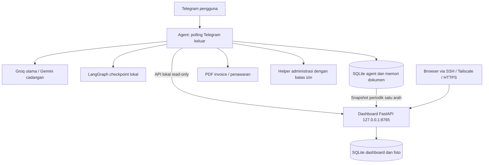

# Buku panduan teknisi TosBot AI Agent

**Acuan:** TosBot AI Agent v1.13.0 · MULTITEK Operations Dashboard v0.3.0
**Baseline Git:** `3c77116` (tag `v1.13.0`) · November 2026
**Sasaran:** teknisi Linux, pengelola VPS, administrator Telegram dan dashboard.

Panduan ini berdasarkan source v1.13.0 dan hasil pengujian upgrade VPS: 13 tes upgrade lulus, suite publikasi 109 lulus dari 110, satu tes visual PDF dilewati karena PyMuPDF tidak terpasang; LangGraph persistence lulus. Push branch `main` dan tag berhasil. Status halaman GitHub Release harus diperiksa terpisah. Instalasi bersih di VPS kedua belum diuji langsung; lakukan checklist penerimaan sebelum produksi. Versi dashboard adalah versi source, bukan bukti dashboard aktif di setiap VPS. Dokumen ini mengutamakan konfigurasi aman untuk pemasangan baru, bukan menyalin izin produksi tanpa pemeriksaan.

## Daftar isi

- [1. Arsitektur dan inventaris](#1-arsitektur-dan-inventaris)
- [2. Instalasi VPS baru](#2-instalasi-vps-baru)
- [3. Telegram, AI dan identitas perusahaan](#3-telegram-ai-dan-identitas-perusahaan)
- [4. Dashboard dan akses tanpa IP publik](#4-dashboard-dan-akses-tanpa-ip-publik)
- [5. Perintah operasional Telegram](#5-perintah-operasional-telegram)
- [6. Invoice, penawaran dan memori](#6-invoice-penawaran-dan-memori)
- [7. Maintenance dan audit](#7-maintenance-dan-audit)
- [8. Backup, restore dan migrasi](#8-backup-restore-dan-migrasi)
- [9. Upgrade dan rollback](#9-upgrade-dan-rollback)
- [10. Troubleshooting](#10-troubleshooting)
- [11. GitHub dan rilis](#11-github-dan-rilis)
- [12. Checklist dan serah terima](#12-checklist-dan-serah-terima)

## 1. Arsitektur dan inventaris



Bot memakai polling keluar, jadi tidak membutuhkan IP publik, webhook, atau port masuk khusus. Dashboard merupakan aplikasi terpisah dan opsional. Memori LangGraph (percakapan) berbeda dengan `document_memory` (snapshot dokumen final). API bridge bukan sinkronisasi dua arah penuh. Groq wajib dikonfigurasi; Gemini opsional.

| Fungsi | Lokasi default |
|---|---|
| Clone Git (contoh) | `/home/tosbot/script/ai-agent/tosbot-agent-public` |
| Runtime agent | `/opt/tosbot-ai/src/tosbot_ai/` |
| Python agent | `/opt/tosbot-ai/venv/bin/python` |
| Konfigurasi agent | `/etc/tosbot-ai/tosbot.env` |
| Data agent | `/var/lib/tosbot-ai/` |
| Database utama | `/var/lib/tosbot-ai/tosbot.sqlite3` |
| Checkpoint | `/var/lib/tosbot-ai/tosbot-conversation.sqlite3` |
| PDF agent | `/var/lib/tosbot-ai/documents/` |
| Aset PDF | `/opt/tosbot-ai/assets/` |
| User service | `tosbot-ai`, `tosbot-terminal` (shell terbatas) |
| Data terminal terbatas | `/var/lib/tosbot-terminal/` |
| Broker admin | `/var/lib/tosbot-ai-admin/`, `/run/tosbot-ai-admin/` |
| Auth admin/izin grup | `/etc/tosbot-ai/admin-auth.json`, `/etc/tosbot-ai/trusted-groups.json` (opsional, root-only) |
| Allowlist systemd | `/etc/tosbot-ai/allowed-services.txt` |
| Unit utama | `tosbot-ai.service` |
| Runtime dashboard | `/opt/tosbot-dashboard/` |
| Konfigurasi dashboard | `/etc/tosbot-dashboard/dashboard.env` |
| Data dashboard | `/var/lib/tosbot-dashboard/` (database, PDF, import, foto, branding) |
| Unit dashboard | `tosbot-dashboard.service`, `tosbot-dashboard-sync.service`, `tosbot-dashboard-sync.timer` |
| Log | journal systemd; `/var/log/tosbot-ai/` disediakan installer |

Source clone/ZIP bukan runtime. Mengedit clone tidak langsung mengubah bot; `install.sh` menyalin source ke `/opt`. Jangan edit runtime secara permanen tanpa perubahan Git yang terdokumentasi.

## 2. Instalasi VPS baru

### 2.1 Persiapan

Gunakan Ubuntu dengan systemd, akses sudo/SSH, DNS dan HTTPS keluar, Python 3/venv, ruang disk untuk data/foto/backup. Installer memasang dependensi melalui apt dan pip; versi paket mengikuti `requirements.txt`, bukan lockfile yang sepenuhnya reproducible. Rekomendasi awal teknisi: 2 vCPU, 2 GB RAM untuk agent saja atau 4 GB jika dashboard juga berjalan; sesuaikan beban, bukan syarat minimum yang telah dibenchmark. Unit agent memiliki `MemoryMax=850M` dan `TasksMax=70`, dashboard `450M` dan `60`.

```bash
hostnamectl
cat /etc/os-release
free -h
df -h /
df -i /
timedatectl
sudo apt-get update
sudo apt-get install -y git ca-certificates curl
```

Siapkan bot baru dari BotFather bila VPS kedua akan beroperasi paralel. **Satu token polling hanya untuk satu instance aktif.** Untuk migrasi token lama, matikan instance sumber sebelum menjalankan tujuan. Jangan masukkan token atau kunci API ke command line, Git atau grup.

### 2.2 Checkout source tetap

```bash
sudo mkdir -p /home/tosbot/script/ai-agent
sudo git clone https://github.com/multitek-indo/tosbot-agent.git \
  /home/tosbot/script/ai-agent/tosbot-agent-public
cd /home/tosbot/script/ai-agent/tosbot-agent-public
sudo git fetch --tags origin
sudo git checkout --detach v1.13.0
cat VERSION
cat dashboard/VERSION
sudo git rev-parse --short HEAD
```

Expected: `1.13.0`, `0.3.0`, commit tag sesuai repository. Jika repo privat, pakai akses baca yang sah; tidak perlu Deploy Key tulis pada VPS yang hanya menjalankan aplikasi. Jika target sudah ada, jangan clone di atasnya; periksa `git status` atau gunakan direktori baru. `detached HEAD` normal pada deployment tag. Tag ini tetap dapat dipakai walau halaman Release belum dibuat.

### 2.3 Instal agent

```bash
sudo bash install.sh
sudoedit /etc/tosbot-ai/tosbot.env
```

Installer membuat user sistem, helper sudo yang terbatas, direktori data, venv dan unit systemd; mengaktifkan autostart, tetapi tidak langsung menjalankan agent. `/home/tosbot` harus ada karena unit menggunakan `BindPaths=/home/tosbot:/run/tosbot-home`; langkah clone telah membuat parent tersebut. Jangan memberi sudo bebas kepada user service. Untuk server baru, gunakan konfigurasi pada bagian 3.

```bash
sudo systemctl start tosbot-ai
sudo systemctl status tosbot-ai -l --no-pager
sudo journalctl -u tosbot-ai -b -n 60 --no-pager
PYTHONPATH=/opt/tosbot-ai/src /opt/tosbot-ai/venv/bin/python \
  -c 'import tosbot_ai; print(tosbot_ai.__version__)'
```

Expected: `active (running)`, `1.13.0`, log startup serta LangGraph enabled. Status running saja tidak membuktikan Telegram/AI berhasil; uji `/help`, `/status`, dan pertanyaan natural. Pada VPS baru tanpa kebutuhan dashboard, bagian 4 bisa dilewati.

## 3. Telegram, AI dan identitas perusahaan

### 3.1 Konfigurasi dasar

Edit file produksi dengan `sudoedit /etc/tosbot-ai/tosbot.env`. Contoh variabel (jangan mengganti file produksi seluruhnya):

```ini
TELEGRAM_BOT_TOKEN=ISI_TOKEN_BOTFATHER
TELEGRAM_OWNER_ID=0
GROQ_API_KEY=
GROQ_MODEL=openai/gpt-oss-120b
GROQ_BASE_URL=https://api.groq.com/openai/v1
GEMINI_API_KEY=
GEMINI_MODEL=gemini-2.5-flash
GEMINI_BASE_URL=https://generativelanguage.googleapis.com/v1beta/openai
AI_PRIMARY=groq
AI_TIMEOUT=40
TZ=Asia/Jakarta
TELEGRAM_GROUPS_ENABLED=false
TELEGRAM_ALLOWED_GROUP_IDS=
TELEGRAM_GROUP_OPERATIONS_ENABLED=false
TELEGRAM_TRUSTED_GROUP_ADMIN=false
```

Model di atas adalah default source, bukan jaminan ketersediaan provider pada masa mendatang. Isi token dan Groq key nyata secara privat; `AI_PRIMARY` wajib `groq`. `owner_id=0` adalah mode onboarding: kirim `/myid` di chat pribadi bot, isi ID numerik ke `TELEGRAM_OWNER_ID`, restart. Chat pribadi selain owner ditolak (kecuali `/myid`). Gemini fallback memerlukan key valid.

```bash
sudo chown root:tosbot-ai /etc/tosbot-ai/tosbot.env
sudo chmod 0640 /etc/tosbot-ai/tosbot.env
sudo systemctl restart tosbot-ai
sudo /opt/tosbot-ai/venv/bin/python /opt/tosbot-ai/scripts/doctor.py
# Opsional: benar-benar memanggil API; dapat memakai kuota.
sudo /opt/tosbot-ai/venv/bin/python /opt/tosbot-ai/scripts/doctor.py --test-api
```

### 3.2 Identitas bisnis dan aset PDF

Isi `COMPANY_NAME`, `COMPANY_ADDRESS`, `COMPANY_PHONE`, `COMPANY_EMAIL`, `COMPANY_BANK`, `COMPANY_ACCOUNT`, `COMPANY_ACCOUNT_NAME`, `COMPANY_SIGNER`, `COMPANY_CITY`. Periksa rekening dan nama penandatangan dengan pihak berwenang. Upload aset melalui SSH/SFTP ke lokasi sementara privat, kemudian:

```bash
sudo install -o root -g root -m 0644 /path/to/private/logo.png /opt/tosbot-ai/assets/logo.png
sudo install -o root -g root -m 0644 /path/to/private/offer-signature.png /opt/tosbot-ai/assets/offer-signature.png
sudo systemctl restart tosbot-ai
```

Ganti path contoh dengan file asli. Invoice dapat dibuat tanpa logo, dan tidak memakai tanda tangan tulisan tangan; penawaran sengaja gagal bila aset tanda tangan tidak tersedia. Logo dashboard berbeda dari logo PDF. Jangan commit logo, tanda tangan, rekening produksi atau dokumen pelanggan.

### 3.3 Grup Telegram

Di BotFather aktifkan group joining; undang bot. Coba `@nama_bot halo` atau `/help@nama_bot`. Di env, set `TELEGRAM_GROUPS_ENABLED=true` dan `TELEGRAM_ALLOWED_GROUP_IDS` ke ID negatif grup yang disetujui. Untuk menemukan ID, `/groupid` dengan mention saat allowlist sementara kosong; lakukan hanya pada grup privat yang dikendalikan, lalu isi allowlist segera. Untuk diagnostik terbatas, `TELEGRAM_GROUP_OPERATIONS_ENABLED=true` membutuhkan allowlist tidak kosong. Restart.

v1.13.0 mendukung **mention dan Reply langsung ke pesan asli bot**; pesan grup biasa tidak dilayani. Reply ke bot lain tidak memicu TosBot. `/sh`, `/sudo` dan terminal memerlukan mention eksplisit di grup. Mulai dengan privacy mode aktif; jika mention tidak diterima, periksa username dan izin bot. Bila perlu matikan privacy mode di BotFather dan tambahkan ulang bot; jelaskan bahwa Telegram dapat mengirim semua pesan grup ke proses bot. Menjadikan bot administrator tidak wajib dan dapat memperluas akses; gunakan izin minimum.

**Trusted group:** source memiliki mode opsional yang memberikan akses bisnis dan root tanpa autentikasi individual kepada seluruh anggota satu grup yang diizinkan. Ini berarti satu akun Telegram yang dibajak dapat mengambil alih VPS. Jangan gunakan pada grup umum atau grup yang anggotanya bukan admin server. Untuk instalasi baru biarkan `TELEGRAM_TRUSTED_GROUP_ADMIN=false`; gunakan SSH/Tailscale untuk root dan chat pribadi untuk bisnis. Mode ini memerlukan tepat satu ID grup serta file root-only terpisah, bukan sekadar flag env. Rujuk [panduan trusted group](../TRUSTED_GROUP_SETUP.md) hanya untuk memahami instalasi yang sudah ada; ID dan contoh lama bukan konfigurasi VPS baru. Untuk menonaktifkannya, set flag false dan `enabled:false` pada file `/etc/tosbot-ai/trusted-groups.json` jika ada, lalu restart. Periksa dan cabut akses grup yang tidak diperlukan. Jangan menempel isi file auth/OTP ke chat.

## 4. Dashboard dan akses tanpa IP publik

Dari clone pada tag:

```bash
cd /home/tosbot/script/ai-agent/tosbot-agent-public/dashboard
sudo bash install.sh
sudo -u tosbot-dashboard /opt/tosbot-dashboard/venv/bin/python \
  /opt/tosbot-dashboard/scripts/set_password.py
curl -fsS http://127.0.0.1:8765/healthz
sudo systemctl status tosbot-dashboard --no-pager
```

`set_password.py` mengatur akun `admin` dan mencabut sesi sebelumnya; gunakan hanya onboarding/reset yang disengaja. Password minimum 10 karakter; gunakan password unik yang lebih panjang. Dashboard menyimpan akun, pelanggan/PIC, servis, foto, transaksi dan dokumen. Seluruh admin dashboard setara pada level aplikasi, bukan root Linux. Foto JPG/PNG/WebP max 5 MB/file, 8 per tiket; bot mengirim maksimal 3 foto per permintaan.

### 4.1 Akses aman

Dari laptop yang dapat SSH ke VPS (misalnya IP Tailscale):

```bash
ssh -N -L 8765:127.0.0.1:8765 USER@ALAMAT_VPS
```

Buka `http://127.0.0.1:8765` pada laptop. Cookie secure default membutuhkan HTTPS; untuk HTTP loopback melalui tunnel saja, bila login berulang, teknisi dapat menonaktifkan `DASHBOARD_COOKIE_SECURE` sementara di env dashboard dan restart; aktifkan kembali sebelum akses publik. Lebih baik gunakan HTTPS yang dilindungi.

Untuk Cloudflare Tunnel yang sudah dikelola, arahkan hostname ke `http://127.0.0.1:8765`, lindungi dengan Cloudflare Access/MFA dan login dashboard. Installer TosBot tidak memasang/mengatur Cloudflare atau Tailscale. Jangan membuka port 8765 ke Internet. Cek tunnel dan Tailscale bila tersedia:

```bash
systemctl status tailscaled cloudflared --no-pager
ss -lnt | grep ':8765'
curl -fsS http://127.0.0.1:8765/healthz
```

Jika cloudflared bukan unit systemd, cek sesuai metode deploy tunnel Anda. Bot sendiri tidak membutuhkan tunnel.

### 4.2 Bridge dan timer

```bash
sudo bash /opt/tosbot-dashboard/scripts/connect_telegram.sh
curl -fsS http://127.0.0.1:8765/healthz
sudo systemctl status tosbot-ai tosbot-dashboard tosbot-dashboard-sync.timer --no-pager
systemctl list-timers --all | grep tosbot
```

Script menyamakan key internal dan merestart layanan; ulangi health check bila startup belum selesai. Key disimpan di kedua env (`DASHBOARD_BRIDGE_TOKEN`, `TOSBOT_DASHBOARD_BRIDGE_TOKEN`), URL `TOSBOT_DASHBOARD_URL` lokal. Jangan tampilkan key. Live bridge read-only untuk pelanggan/servis/foto; pengeditan dilakukan di dashboard. Snapshot transaksi agent ke dashboard sekitar dua menit; bukan saldo bank atau sinkronisasi dua arah. Bila perlu refresh manual:

```bash
sudo systemctl start tosbot-dashboard-sync.service
sudo journalctl -u tosbot-dashboard-sync.service -n 30 --no-pager
```

## 5. Perintah operasional Telegram

Contoh di bawah untuk chat pribadi owner kecuali disebut lain; grup biasa memiliki fitur terbatas dan mode trusted mempunyai risiko tersendiri. Gunakan `@nama_bot` sesuai username aktual di grup. Tidak semua bahasa bebas pasti didukung; periksa jawaban dan izin.

| Perintah | Fungsi |
|---|---|
| `/help`, `/start`, `/bantuan` | Bantuan |
| `/myid` | ID pengguna untuk onboarding |
| `/status`, `/server` | Status VPS |
| `/disk`, `/storage` | Kapasitas penyimpanan |
| `/ram`, `/memori` | RAM |
| `cek status nginx` | Status unit, jika valid/diizinkan |
| `cd home`, `cd script`, `pwd`, `ls` | Konteks direktori; fungsi direktori dibatasi pada home TosBot |
| `buat folder test di /home/tosbot` | Pembuatan folder yang diizinkan, memerlukan konfirmasi |
| `ping ke 192.0.2.1 sebanyak 4 kali` | Contoh sintaks ping; gunakan host Anda yang dapat diakses |
| `/keuangan`, `/finance` | Laporan keuangan |
| `catat pengeluaran bensin 50 ribu` | Catat transaksi nyata |
| `/pengingat`, `/reminders` | Daftar pengingat |
| `ingatkan besok jam 9 bayar listrik` | Membuat pengingat |
| `/batal`, `/cancel` | Batalkan draft/konfirmasi admin yang tertunda; bukan menghapus dokumen final |
| `daftar pelanggan`, `status servis #2`, `foto servis #2` | Data bridge dashboard bila terhubung dan diizinkan |

### Terminal (utamakan SSH untuk perubahan server)

| Perintah pribadi | Fungsi |
|---|---|
| `/terminal` | Bantuan terminal |
| `/sh whoami`, `/sh df -h`, `/bash uptime` | Shell sebagai `tosbot-terminal` terbatas, tergantung sesi/izin |
| `sudo su` atau `/rootlogin` | Memulai alur autentikasi admin yang sudah dikonfigurasi |
| `/auth KODE` | Validasi kode TOTP 6 digit; jangan bagikan rahasia TOTP |
| `/sudo PERINTAH` | Jalur admin saat sesi aktif (5 menit); perintah berisiko membutuhkan persetujuan |
| `/approve TOKEN` | Persetujuan perintah tertentu dalam 90 detik, jangan setujui bila tidak yakin |
| `/cancelcmd` | Batalkan perintah tertunda |
| `/jobs`, `/job ID` | Daftar/status job |
| `/exit` | Tutup sesi root |

Root pribadi nonaktif sampai setup dari terminal admin SSH dengan `sudo /usr/local/sbin/tosbot-ai-admin-ctl setup`. Simpan rahasia authenticator secara privat. Untuk mencabut akses pribadi root, `sudo /usr/local/sbin/tosbot-ai-admin-ctl disable`; ini bukan pengganti penonaktifan trusted group. Jangan menjalankan editor interaktif atau perintah yang membaca secret via Telegram. Tidak ada E2EE pada bot Telegram. Gunakan SSH untuk perubahan sudoers, firewall, penghapusan, pemulihan, dan instalasi.

Service restart natural membutuhkan allowlist di `ADMIN_ALLOWED_SERVICES` serta file root-managed `/etc/tosbot-ai/allowed-services.txt`. Isi hanya unit yang benar-benar perlu dikelola, satu nama unit per baris di file. Jangan memberi izin blanket; uji terlebih dahulu dengan status read-only dan lakukan restart dari SSH untuk service kritis.

## 6. Invoice, penawaran dan memori

Contoh data fiktif:

```text
Buatkan invoice kepada Pak Contoh di PT Demo, alamat Jalan Contoh 1, 1 unit Mesin A seharga 1.150.000 dengan nomor PO customer PO-DEMO-001
koreksi PIC menjadi Pak Demo
ganti PO customer PO-DEMO-002
sudah sesuai, buat PDF
```

`number` = nomor invoice internal, `po_number` = PO dari customer, `attention` = PIC, `customer` = perusahaan. Jika tidak memberikan nomor invoice manual, database menetapkan nomor otomatis saat finalisasi. PO tidak boleh menggantikan nomor invoice. Pastikan draft menampilkan kedua nomor terpisah, cek alamat, item, harga, kuantitas, diskon, tanggal PO, pembayaran dan total. Jangan setujui jika belum benar. PDF lama tidak diubah dengan mengubah draft baru. Gunakan prosedur administrasi perusahaan untuk pembatalan/penggantian invoice final.

Setelah satu dokumen nyata diterbitkan pada v1.13.0, contoh reuse:

```text
Buat invoice terakhir
Buat invoice untuk PT Demo seperti kemarin, jumlah 3 unit, PO baru PO-DEMO-003
Buat penawaran terakhir
Gawekno invoice koyo wingi
```

- Memori terisi dari dokumen final sejak upgrade; riwayat lama tidak otomatis dimigrasikan.
- Scope mengikuti owner/chat. Trusted group memakai scope grup bersama, sehingga anggota dapat mengakses data dokumen grup tersebut. Tidak berarti privat per anggota.
- Pemilihan nama dinormalisasi secara terbatas, PIC ambigu memerlukan perusahaan lengkap. Jenis invoice/penawaran terpisah. Gunakan `/batal` sebelum menyalin bila draft masih aktif.
- PO lama, nomor, diskon, tanggal PO, ketentuan dan catatan lama tidak ikut disalin; pembayaran kembali default. Harga historis wajib diperiksa. Gunakan koma/titik koma untuk memisahkan perubahan. Multi-item: salin dulu lalu koreksi per nomor item.
- Tidak ada penghapusan riwayat melalui Telegram pada v1.13.0. Atur retensi data/backup secara administratif, jangan menghapus tabel secara spontan.
- Dukungan bahasa Jawa/typo terbatas pada pola yang diuji; bukan peningkatan NLU semua modul.

## 7. Maintenance dan audit

### 7.1 Quick check dari SSH

```bash
sudo systemctl is-active tosbot-ai
sudo systemctl is-enabled tosbot-ai
sudo systemctl status tosbot-ai -l --no-pager
sudo journalctl -u tosbot-ai --since '1 hour ago' --no-pager
sudo journalctl -u tosbot-ai -p warning -b --no-pager
sudo systemctl show tosbot-ai -p MainPID -p MemoryCurrent -p NRestarts -p TasksCurrent
free -h
df -h /
df -i /
```

Untuk memantau real time: `sudo journalctl -u tosbot-ai -f` (Ctrl+C berhenti memantau, bukan menghentikan service). Restart yang disengaja: `sudo systemctl restart tosbot-ai`; stop/start bila maintenance. `systemctl daemon-reload` hanya diperlukan setelah file unit berubah. Jangan restart berulang tanpa membaca penyebab. Jangan menghapus journal atau database untuk menghilangkan warning.

### 7.2 Alat audit bawaan

```bash
sudo bash /opt/tosbot-ai/scripts/audit-vps.sh
sudo /opt/tosbot-ai/venv/bin/python /opt/tosbot-ai/scripts/doctor.py
sudo -u tosbot-ai env PYTHONPATH=/opt/tosbot-ai/src LANGGRAPH_STRICT_MSGPACK=true \
  /opt/tosbot-ai/venv/bin/python /opt/tosbot-ai/scripts/check_langgraph.py \
  --state-dir /var/lib/tosbot-ai
sudo visudo -cf /etc/sudoers.d/tosbot-ai
```

Audit memeriksa izin file, sandbox, disk/RAM, LangGraph dengan state sementara; bukan sertifikasi keamanan. Baca hasil masing-masing pemeriksaan. Jangan mengirim log mentah yang mengandung data pelanggan atau kredensial.

### 7.3 SQLite (read-only)

```bash
sudo /opt/tosbot-ai/venv/bin/python - <<'PY'
import sqlite3
from contextlib import closing
from pathlib import Path
p = Path('/var/lib/tosbot-ai/tosbot.sqlite3')
with closing(sqlite3.connect(p.as_uri()+'?mode=ro', uri=True, timeout=10)) as c:
    print('quick_check:', c.execute('PRAGMA quick_check').fetchone()[0])
    for name in ('documents','document_memory','drafts','finance','reminders'):
        exists=c.execute('SELECT 1 FROM sqlite_master WHERE type=? AND name=?', ('table',name)).fetchone()
        if exists: print(name, c.execute('SELECT count(*) FROM '+name).fetchone()[0])
PY
```

Hanya menampilkan jumlah baris, bukan isi pelanggan. Jalankan saat beban rendah; `quick_check` dapat memakan waktu bila database besar. Jika locked/corrupt, jangan paksa repair atau hapus `-wal`/`-shm`; ikuti bagian 10. Periksa jalur bila instalasi menggunakan path kustom.

### 7.4 Jadwal teknisi yang disarankan

| Interval | Tindakan |
|---|---|
| Harian | Status unit, log startup/error, disk/RAM, health dashboard |
| Mingguan | Backup konsisten, cek arsip dan salinan off-host; pantau timer sinkronisasi |
| Bulanan | Uji restore di VPS uji, audit akses grup/admin, izin file, key dan pembaruan OS |
| Sebelum upgrade | Backup, test source, cek release notes, rencanakan downtime dan rollback |
| Sesudah upgrade | Versi runtime, unit, LangGraph, Telegram, bridge, draft/PO, PDF |

Jadwal merupakan rekomendasi operasional, bukan otomatisasi bawaan. Jangan menjalankan `apt upgrade`/pip upgrade tanpa backup dan jendela maintenance; periksa reboot yang diperlukan. Simpan snapshot konfigurasi dan dependency sebelum perubahan.

## 8. Backup, restore dan migrasi

### 8.1 Backup konsisten (downtime terencana)

Jalankan dari SSH sebagai root, bukan melalui Telegram. Script berikut menghentikan unit yang aktif, termasuk timer/sync dashboard jika ada, lalu mengarsipkan direktori yang tersedia. Service yang sebelumnya aktif dijalankan kembali melalui trap jika terjadi error. Hentikan pekerjaan terminal root yang masih berjalan dan perubahan oleh teknisi lain sebelum mulai; proses eksternal tidak otomatis dihentikan. Jangan gunakan saat proses migrasi sedang berjalan.

```bash
sudo bash <<'BACKUP'
set -Eeuo pipefail
umask 077
install -d -m 0700 /root/tosbot-backups
stamp=$(date -u +%Y%m%dT%H%M%SZ)
archive="/root/tosbot-backups/tosbot-$stamp.tar.gz"
units=(tosbot-dashboard-sync.timer tosbot-dashboard-sync.service tosbot-dashboard.service tosbot-ai.service)
active=()
resume() {
  for ((i=${#active[@]}-1; i>=0; i--)); do
    systemctl start "${active[i]}" || echo "PERIKSA: ${active[i]} gagal start" >&2
  done
}
trap resume EXIT
for unit in "${units[@]}"; do
  if systemctl is-active --quiet "$unit"; then
    active+=("$unit")
    systemctl stop "$unit"
  fi
done
paths=()
for p in etc/tosbot-ai var/lib/tosbot-ai var/lib/tosbot-terminal var/lib/tosbot-ai-admin \
  opt/tosbot-ai/assets etc/tosbot-dashboard var/lib/tosbot-dashboard \
  etc/systemd/system/tosbot-ai.service etc/systemd/system/tosbot-dashboard.service \
  etc/systemd/system/tosbot-dashboard-sync.service etc/systemd/system/tosbot-dashboard-sync.timer \
  etc/sudoers.d/tosbot-ai; do
  [[ ! -e /$p ]] || paths+=("$p")
done
((${#paths[@]})) || { echo 'Tidak ada data ditemukan'; exit 1; }
tar -C / -czf "$archive" "${paths[@]}"
tar -tzf "$archive" >/dev/null
sha256sum "$archive" > "$archive.sha256"
echo "Backup: $archive"
BACKUP
```

Backup mengandung token, password hash, TOTP, PDF, foto dan data pelanggan. Simpan root-only, enkripsi sebelum transfer/offsite, batasi akses dan tetapkan retensi sesuai kebijakan. Backup tidak menyertakan SSH private key, tunnel credentials, data OS lain atau seluruh venv. Catat versi runtime, tag/commit dan dependency secara terpisah. `tar -tzf` dan checksum hanya memeriksa integritas arsip, bukan kelengkapan pemulihan. Uji restore di VPS terisolasi. Periksa bahwa unit yang semula aktif sudah kembali `active`.

### 8.2 Restore data pada VPS yang sama

1. Tentukan backup dan waktu pemulihan; data yang dibuat setelah backup dapat hilang jika database diganti. Buat backup kondisi saat ini terlebih dahulu.
2. Cocokkan versi aplikasi dengan backup; untuk pemulihan v1.13.0 gunakan source tag yang sama. Hentikan agent, dashboard dan timer/sync yang terpasang sebelum mengganti data.
3. Verifikasi checksum dan ekstrak ke staging root-only, **bukan langsung ke `/`**:

```bash
sudo -i
cd /root/tosbot-backups
# Ganti dengan nama arsip yang benar.
archive=tosbot-YYYYMMDDTHHMMSSZ.tar.gz
sha256sum -c "$archive.sha256"
tar -tzf "$archive"
stage=$(mktemp -d /root/tosbot-restore-XXXXXX)
tar -xzf "$archive" -C "$stage" --no-same-owner
printf 'Staging: %s\n' "$stage"
```

4. Tinjau isi staging. Restore **set direktori data utuh** (termasuk WAL/SHM bila terdapat dalam backup konsisten), bukan menggabungkan file SQLite lama dan baru. Pindahkan direktori produksi ke nama cadangan unik, lalu salin direktori staging ke path aslinya, dengan service berhenti. Contoh khusus data agent, hanya jika staging benar dan sudah diverifikasi:

```bash
# Dalam shell root yang sama, service terkait telah dihentikan.
test -f "$stage/var/lib/tosbot-ai/tosbot.sqlite3"
stamp=$(date -u +%Y%m%dT%H%M%SZ)
mv /var/lib/tosbot-ai "/var/lib/tosbot-ai.before-restore-$stamp"
cp -a "$stage/var/lib/tosbot-ai" /var/lib/tosbot-ai
chown -R tosbot-ai:tosbot-ai /var/lib/tosbot-ai
chmod 0750 /var/lib/tosbot-ai /var/lib/tosbot-ai/documents
```

Jika `mv` atau `cp` gagal, jangan start; pulihkan direktori yang baru saja dipindahkan. Untuk dashboard, lakukan pendekatan yang sama pada `/var/lib/tosbot-dashboard` dengan owner `tosbot-dashboard:tosbot-dashboard` dan mode direktori utama `0700`. Jangan menimpa env, unit, sudoers atau auth broker secara membabi buta: bandingkan dan kembalikan hanya konfigurasi yang diperlukan, pastikan root ownership, `tosbot.env` mode `0640` group `tosbot-ai`, dashboard env `0640` group `tosbot-dashboard`, `trusted-groups.json` dan `admin-auth.json` root-only `0600`, sudoers `0440` dan lolos `visudo`. Aset PDF root-owned `0644`. Periksa path custom. Data broker job/session tidak dianjurkan dipindahkan ke VPS baru; buat ulang autentikasi melalui SSH.

5. Jalankan pemeriksaan SQLite read-only (bagian 7), cek izin, reload systemd bila unit berubah, start layanan yang digunakan, cek health/log dan uji Telegram. Jangan hapus staging/cadangan sebelum pemulihan disetujui.

### 8.3 Migrasi ke VPS lain

**Instalasi independen:** gunakan bot token baru, owner ID dan DB baru. Tidak perlu memindahkan data. **Migrasi:** install versi yang sama di VPS tujuan, siapkan transfer arsip melalui SSH/SFTP yang aman, pulihkan data seperti di atas. Agent harus berhenti di kedua sisi selama cutover database; timer/dashboard juga dihentikan selama snapshot. Jangan menjalankan token yang sama pada dua VPS. Pastikan owner/group ID yang dipilih cocok dengan scope data lama; mengganti owner bisa membuat riwayat tidak terlihat. Tinjau bridge URL/token, identitas bisnis, dan path PDF/aset. Hindari menyalin sudoers, TOTP, sesi root, deploy key, atau pengaturan grup trusted tanpa peninjauan. Reconfigure akses SSH/Tailscale dan Cloudflare untuk host baru secara terpisah. Buat ulang credential yang perlu; jangan publish backup.

Urutan cutover: backup → install tujuan tanpa start polling → stop sumber dan ambil snapshot final → transfer/restore → start tujuan → uji Telegram, memori, PDF dan dashboard → biarkan sumber nonaktif. Bila cutover gagal, stop tujuan sebelum kembali menyalakan sumber. Jika tujuan sudah membuat transaksi/invoice, rekonsiliasi nomor dokumen/data terlebih dahulu untuk mencegah duplikasi. Jangan sekadar menjalankan dua instance untuk failover.

## 9. Upgrade dan rollback

Untuk v1.12.3 dengan hotfix, paket upgrade v1.13.0 yang sebelumnya digunakan mengganti modul runtime yang berubah, menjalankan tes, membuat backup source dan restart. Pada VPS yang sudah v1.13.0 tidak perlu mengulanginya. Untuk versi lain, ikuti dokumentasi release yang sesuai, bukan memasang hotfix di atas versi yang tidak cocok.

Alur standar upgrade dari Git: backup konsisten dan catat versi/dependency, checkout tag target di clone bersih, jalankan pemeriksaan publikasi dan tes dengan environment yang sesuai. Hentikan agent sebelum `install.sh` (installer menyalin ulang source dan tidak otomatis menghentikan agent). Jalankan installer, tinjau env yang dipertahankan, mulai agent dan cek acceptance. Upgrade dashboard hanya jika diperlukan. Jangan menjalankan `git pull` pada detached HEAD; jangan `git reset --hard` atau `git push --force` untuk menyelesaikan konflik.

```bash
cd /home/tosbot/script/ai-agent/tosbot-agent-public
sudo git status --short
sudo git fetch origin --tags
# Gunakan tag yang telah ditinjau; contoh baseline:
sudo git checkout --detach v1.13.0
sudo systemctl stop tosbot-ai
sudo bash install.sh
sudo systemctl start tosbot-ai
sudo systemctl status tosbot-ai -l --no-pager
```

Jalankan langkah hanya setelah backup; jika install gagal, jangan lanjut start sampai source/dependency dipulihkan. Backup source hotfix bukan backup DB. Rollback source hanya aman jika schema/data kompatibel; untuk perubahan schema, restore backup konsisten pra-upgrade setelah mempertimbangkan hilangnya transaksi baru. Tabel `document_memory` ditambahkan otomatis pada v1.13.0, tidak dihapus oleh rollback source. Simpan versi lama sebagai tag; jangan mengubah tag yang sudah dipublikasikan. Untuk rollback, checkout tag lama yang telah diuji dan gunakan installer/dependency yang sesuai, atau pulihkan source dari backup terverifikasi. Pastikan service hidup dan uji kembali.

## 10. Troubleshooting

Mulai dari gejala, cek log sejak kejadian terakhir (bukan hanya pesan lama), identifikasi lapisan yang gagal, lakukan perbaikan minimum dan verifikasi. Gunakan waktu UTC/jurnal serta `TZ=Asia/Jakarta` pada aplikasi agar timestamp mudah dibandingkan.

| Gejala | Pemeriksaan / tindakan |
|---|---|
| Service gagal start | `systemctl status tosbot-ai -l` dan `journalctl -u tosbot-ai -b -n 100`; periksa env, Python, path `/home/tosbot`, permission, disk. Jangan reinstall sebelum sebab diketahui. |
| Bot diam seluruhnya | Cek startup, token, akses keluar Telegram, `/myid`, owner, polling lain. |
| Bot diam hanya di grup | Cek group joining, allowlist, mention username asli, Reply ke bot asli, privacy mode, mode trusted vs biasa; restart setelah edit. |
| Telegram HTTP 409 | Sering berarti polling bersamaan atau webhook masih aktif; cek semua VPS/container lama dan hentikan instance lain. Jangan hapus webhook atau rotate token sebelum mengetahui deployment yang aktif. |
| Telegram HTTP 429 | Rate limit; biarkan backoff, kurangi frekuensi request, jangan restart berulang. |
| Telegram 502 / ReadTimeout / ConnectError | Bisa gangguan upstream atau DNS/jaringan lokal; cek konektivitas dan log baru, retry otomatis. |
| AI unavailable / 401 / 403 | `doctor.py --test-api`, cek Groq key, model, quota/izin; Gemini opsional. Jangan menaruh key di log. |
| AI 429 / timeout | Kuota/rate limit, provider sedang sibuk; hindari request berulang, cek provider dan `AI_TIMEOUT`. |
| LangGraph tidak aktif | Cek dependency di venv, izin checkpoint, `check_langgraph.py`; bot bisa fallback legacy history. |
| PO masuk NO | Cek versi runtime 1.13.0, gunakan frasa `PO customer ...`, cek draft sebelum final, batalkan draft salah; jangan mengubah PDF final manual tanpa prosedur. |
| Memori tidak menemukan invoice | Harus ada dokumen final sesudah upgrade, jenis dan scope sama; nama/PIC tepat, bukan draft; PIC ambigu pakai perusahaan. |
| Penawaran gagal render | Periksa aset tanda tangan, font, permission output, disk, log. Logo PDF berbeda dari dashboard. |
| PDF lama tidak berubah | Normal; perubahan draft hanya untuk dokumen baru. |
| SQLite locked/corrupt | Hentikan writer terkoordinasi, backup semua file termasuk WAL/SHM, cek integrity dari salinan; restore backup teruji. Jangan hapus DB. |
| Dashboard 502/tidak dapat diakses | Cek `/healthz` lokal, `ss -lnt`, service dan tunnel; jangan buka port publik sebagai solusi. |
| Login dashboard berulang | Cek HTTPS dan secure cookie; reset password via script hanya bila diperlukan. |
| Bot tidak melihat pelanggan/foto | Cek bridge, scope dan dashboard aktif; sinkronkan bridge bila perlu; foto dari tiket yang tepat. |
| Data transaksi dashboard terlambat | Timer sekitar 2 menit; cek `tosbot-dashboard-sync.service` dan manual refresh. |
| Perintah root ditolak | Gunakan SSH; private root memerlukan setup/TOTP/session, group normal memang ditolak. Jangan memberi blanket sudo. |
| Git `Not a git repository` | Gunakan clone baru, bukan direktori hasil unzip atau `/opt`. |
| Git `Permission denied (publickey)` | Cek key yang benar, akses repo dan deploy key; gunakan `GIT_SSH_COMMAND` dari bagian 11. |
| `command not found` untuk script lokal | Gunakan `bash nama-script.sh` dari direktori yang benar. |

Pemeriksaan jaringan tanpa mencetak token:

```bash
getent ahosts api.telegram.org
getent ahosts api.groq.com
getent ahosts generativelanguage.googleapis.com
curl -I --connect-timeout 10 https://api.telegram.org/
curl -I --connect-timeout 10 https://api.groq.com/
timedatectl
sudo journalctl -u tosbot-ai --since '30 min ago' --no-pager
```

HTTP status non-200 pada root URL API tidak otomatis berarti koneksi gagal: ini hanya uji DNS/TLS/HTTP dasar. Gunakan doctor untuk API AI dan `/help` untuk Telegram aktual. Warning `asyncio.iscoroutinefunction` pada LangSmith dan `ResourceWarning` koneksi SQLite muncul pada suite Python 3.14 tetapi tes lulus; catat untuk perbaikan kode, jangan disembunyikan dengan mematikan semua warning. PyMuPDF opsional untuk tes visual; pasang pada venv pengujian bila dibutuhkan, bukan sebagai syarat runtime.

## 11. GitHub dan rilis

Repository: <https://github.com/multitek-indo/tosbot-agent>. Commit kode v1.13.0 yang berhasil dipush: `3c77116`. Tag `v1.13.0` juga sudah diverifikasi melalui remote. Git tag bukan halaman GitHub Release; buat halaman Release dari tag bila belum tersedia, gunakan catatan release yang sudah disiapkan. Dokumentasi baru setelah tag tidak mengubah isi arsip v1.13.0: baca dokumentasi branch `main`, dan install kode dari tag. Tidak perlu membuat tag software baru untuk perubahan dokumentasi saja.

Pada VPS maintainer yang telah memiliki Deploy Key tulis, gunakan key tersebut tanpa menyalin private key ke server lain. Verifikasi fingerprint host melalui sumber resmi GitHub saat pertama kali terhubung, jangan menonaktifkan pemeriksaan host key. Bila key memiliki passphrase, masukkan secara interaktif atau gunakan ssh-agent. Deploy key tidak memberikan autentikasi GitHub API/CLI.

```bash
export GIT_SSH_COMMAND='ssh -i /root/.ssh/tosbot_github -o IdentitiesOnly=yes'
git ls-remote git@github.com:multitek-indo/tosbot-agent.git HEAD
# ^ Path key contoh pada VPS maintainer; sesuaikan jika berbeda.
```

Untuk perubahan berikutnya, clone repo baru, buat perubahan terarah, periksa diff dan tes, lalu commit/push. Jangan commit dari `/opt` atau direktori yang berisi data produksi. Script `scripts/publish_github.sh` dalam baseline merupakan bootstrap untuk repo kosong, **bukan** alur update repository ini. Contoh preflight (dari root clone):

```bash
python3 scripts/check_public_release.py
PYTHONPATH=src /opt/tosbot-ai/venv/bin/python -m unittest discover -s tests -v
git status --short
git diff --check
git diff --cached --check
```

Jangan mengunggah env, token, API key, file admin-auth, trusted group, database, backup, invoice, foto, logo, signature, data pelanggan, atau SSH key. Scanner hanya heuristik; review manual wajib. Gunakan fixture anonim. Untuk release kode baru, buat commit dan tag versi unik setelah tes; push tanpa force dan buat GitHub Release melalui UI (atau `gh release create` bila CLI punya autentikasi dan izin yang sesuai). Jangan mengubah tag lama. Bila branch dilindungi, gunakan PR sesuai kebijakan repo.

## 12. Checklist dan serah terima

- [ ] Tag source, versi runtime dan commit dicatat; versi dashboard diperiksa jika dipasang.
- [ ] User service bukan root, env punya permission benar, tidak ada blanket sudo.
- [ ] Token hanya dipakai pada satu polling aktif, owner terverifikasi, grup dibatasi.
- [ ] Service berjalan dan autostart sesuai kebutuhan; disk/RAM memadai.
- [ ] Doctor dan pemeriksaan LangGraph lulus; `/help`, `/status`, pertanyaan natural berhasil.
- [ ] Draft invoice memisahkan nomor invoice dan PO, PIC dan perusahaan; PDF resmi diperiksa bila memang diperlukan.
- [ ] Memori mengambil dokumen baru dari scope yang benar dan meminta konfirmasi; tidak menerbitkan ulang invoice lama untuk tes.
- [ ] Dashboard HTTPS/akses privat, admin dan timer benar; bridge diuji jika dipasang.
- [ ] Backup terenkripsi/off-host, checksum dan restore diuji; rollback dicatat.
- [ ] Log yang dibagikan telah disanitasi; GitHub tidak mengandung data privat.

Catatan serah terima privat (di luar Git): hostname, IP Tailscale, lokasi clone, versi, tanggal deploy, pemilik layanan, domain dashboard, lokasi backup dan hasil uji restore, kontak eskalasi, kebijakan grup dan akses. Catat referensi vault untuk secret, bukan nilai secret itu sendiri.

### Referensi internal source

- [README utama](../README.md), [CHANGELOG](../CHANGELOG.md), [upgrade v1.13.0](../UPGRADE_V113.md)
- [Keamanan](../SECURITY.md), [trusted group (risiko tinggi)](../TRUSTED_GROUP_SETUP.md)
- [Aset PDF privat](../assets/README.md), [dashboard v0.3.0](../dashboard/UPGRADE_V030.md)
- [`install.sh`](../install.sh), [`audit-vps.sh`](../scripts/audit-vps.sh), [`doctor.py`](../scripts/doctor.py), [`check_langgraph.py`](../scripts/check_langgraph.py)
- [`document_memory.py`](../src/tosbot_ai/document_memory.py), [`storage.py`](../src/tosbot_ai/storage.py), [`terminal.py`](../src/tosbot_ai/terminal.py), [tests](../tests/)

Panduan ini mengutamakan perilaku source v1.13.0 apabila contoh historis di file lain berbeda. Untuk perubahan sesudah versi ini, perbarui dokumentasi bersama pengujian.
